  

  
  
  

🎙️ <i>"...and he's opened ANOTHER tab, folks. you cannot teach that."</i>

---

## 📋 the scouting report

  

## 🏟️ the roster

| | player | pos | stat line | the commentary |
|:-:|---|---|---|---|
| ⭐ | **[flipperclaw](https://github.com/yasher3413/flipperclaw)** | C++ · ESP32 | LLM agent in your pocket, NFC / Sub-GHz / IR tools | franchise player. put a ReAct loop on a 128×64 screen and dared anyone to stop him |
| ⭐ | **[twig](https://github.com/yasher3413/twig)** | TypeScript | lightweight browser for tab hoarders | built a whole browser instead of closing tabs. respect the commitment |
| ⭐ | **[tabled](https://github.com/yasher3413/tabled)** | TypeScript | Canadian federal bills → summaries, status, MP votes | reads legislation so you don't have to. civic MVP |
| 🔁 | [personal-agent](https://github.com/yasher3413/personal-agent) | TypeScript | SMS personal assistant | texts you back faster than your friends do |
| 🔁 | [SEA-TRIP](https://github.com/yasher3413/SEA-TRIP) | TypeScript | AI chief of staff for one (1) trip | overengineering is a lifestyle |
| 🔁 | [claw-code](https://github.com/yasher3413/claw-code) | Rust | harness tools, mid-rewrite to Rust | 🦀 as is tradition |
| 🔁 | [transaction-processing-system](https://github.com/yasher3413/transaction-processing-system) | Go | event-driven txn pipeline | the serious one. doesn't talk to the media |
| 🪑 | [Mini-Bree](https://github.com/yasher3413/Mini-Bree) | Python | earned-wage-access MVP | Next.js + FastAPI two-way player |
| 🪑 | [Recruting-OS](https://github.com/yasher3413/Recruting-OS) | n8n | job posting → fit score → spreadsheet | scouts the scouts |
| 🪑 | [fantasy-football-draft-aid](https://github.com/yasher3413/fantasy-football-draft-aid) | — | draft-day cheat code | did not help. we don't talk about it |

⭐ starter · 🔁 rotation · 🪑 bench (healthy scratch, emotionally)

## 📺 play-by-play

auto-updated every few hours by a GitHub Action with the emotional range of a local radio color guy

<!--PBP:START-->
- 🟠 *pregame. the crew is still setting up the booth, check back after the first drive.*
<!--PBP:END-->

## 🐍 film room

my contribution graph getting eaten alive, much like my team's secondary every sunday

<picture>
  <source media="(prefers-color-scheme: dark)" srcset="https://raw.githubusercontent.com/yasher3413/yasher3413/output/snake-dark.svg">
  <source media="(prefers-color-scheme: light)" srcset="https://raw.githubusercontent.com/yasher3413/yasher3413/output/snake.svg">
  
</picture>

## 🎤 postgame presser

<b>click to take questions from the media</b>

 

> **Q: Why build a browser?**
> closing tabs was never an option. we move forward. all 300 of us.

> **Q: Is the LLM on the Flipper actually useful?**
> it told me my team would make the playoffs. so, no. but it's very confident.

> **Q: What's your stack?**
> TypeScript on offense, C++ when it gets physical, Rust when I want to feel something, Go when the adults are watching.

> **Q: How are you holding up after this season?**
> *(adjusts mic)* ... *(stares into the distance)* ... *(leaves the podium)*

> **Q: Any message for recruiters?**
> my DMs are open. my tabs are open. everything is open. please.

  

