I build things that probably should have stayed side projects: an LLM agent that lives on a Flipper Zero, a browser for people who refuse to close tabs, a tracker for Canadian federal bills. Leafs all winter, Cowboys every Sunday. I have not known joy in some time.

[yashgandhi.org](https://yashgandhi.org) · [linkedin](https://www.linkedin.com/in/yashgandhi34/) · [x](https://x.com/yash_gandhi34)

 

### First line

**[flipperclaw](https://github.com/yasher3413/flipperclaw)** &nbsp;A pocket LLM agent. Flipper Zero for the screen and buttons, an ESP32-S3 running the agent loop, with NFC, Sub-GHz and IR as tools. 
**[twig](https://github.com/yasher3413/twig)** &nbsp;A lightweight browser for heavy tab users. Cheaper than therapy. 
**[tabled](https://github.com/yasher3413/tabled)** &nbsp;Every federal bill in Canada, summarized, with its status and how each MP voted.

### Second line

**[personal-agent](https://github.com/yasher3413/personal-agent)** &nbsp;A personal assistant you text, wired into the productivity tools I actually use. 
**[claw-code](https://github.com/yasher3413/claw-code)** &nbsp;An agent harness with extra tools, partway through a rewrite in Rust. 
**[transaction-processing-system](https://github.com/yasher3413/transaction-processing-system)** &nbsp;Event-driven transaction processing in Go. The serious one. Doesn't talk to the media. 
**[SEA-TRIP](https://github.com/yasher3413/SEA-TRIP)** &nbsp;An AI chief of staff built to plan exactly one trip.

### Healthy scratches

[Mini-Bree](https://github.com/yasher3413/Mini-Bree) · [Recruting-OS](https://github.com/yasher3413/Recruting-OS) · [fantasy-football-draft-aid](https://github.com/yasher3413/fantasy-football-draft-aid) (do not ask how the season went) · [pm-portfolio-monitorhub](https://github.com/yasher3413/pm-portfolio-monitorhub)

### Play-by-play

<!--PBP:START-->
- *pregame. the booth is still finding its headset.*
<!--PBP:END-->

Called automatically from my public GitHub activity every few hours. The counters on the whiteboard update too, sadly.

### Postgame

Take questions from the media

 

**Why build a browser?** 
Closing tabs was never on the table. We go forward, all three hundred of us.

**Is the LLM on the Flipper actually useful?** 
It told me the Leafs would get out of the second round. So no. It is very confident though.

**What's the stack?** 
TypeScript on most downs. C++ when it gets physical. Rust when I want to feel something. Go when an adult is watching.

**Leafs or Cowboys, which one hurts more?** 
*(long pause)* Next question.

**Anything for recruiters?** 
My DMs are open. My tabs are open. Everything is open.

